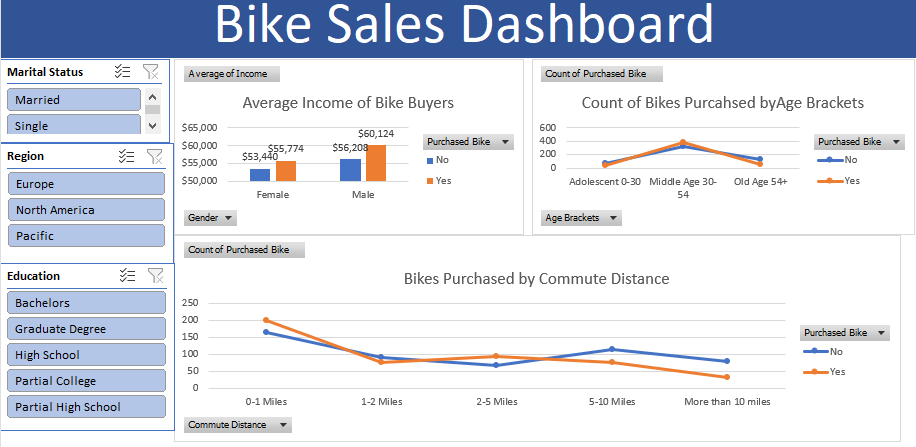

# Bike Sales Dashboard (Excel)

An interactive Excel dashboard that explores which customers buy bikes, built from a customer dataset using data cleaning, pivot tables, and slicers.

## Project Overview

The goal of this project is to understand how customer characteristics such as income, age, gender, and commute distance relate to whether someone purchased a bike. I cleaned the raw data, summarized it with pivot tables, and presented the results in a single interactive dashboard.

## Dataset

The dataset contains customer records with the following fields:

| Column | Description |
|---|---|
| ID | Unique customer ID |
| Marital Status | Married / Single |
| Gender | Male / Female |
| Income | Annual income |
| Children | Number of children |
| Education | Highest education level |
| Occupation | Type of occupation |
| Home Owner | Yes / No |
| Cars | Number of cars owned |
| Commute Distance | Distance to work (0-1 miles up to 10+ miles) |
| Region | Europe / North America / Pacific |
| Age | Customer age |
| Purchased Bike | Yes / No (the outcome I analyzed) |

## Workbook Structure

| Sheet | Purpose |
|---|---|
| `bike_buyers` | Original raw data |
| `Worksheet` | Cleaned, analysis-ready data |
| `Pivot Tables` | Pivot tables and charts used for analysis |
| `Dashboard` | Final interactive dashboard |

## Data Cleaning Steps

- Replaced abbreviations with readable labels (`M`/`S` became **Married**/**Single**, `M`/`F` became **Male**/**Female**)
- Formatted the Income column as currency
- Created an **Age Brackets** column to group customers (e.g. Middle Age 30-54, Old Age 54+)
- Added filters to every column header for easy exploration
- Checked for duplicates and inconsistent values

## Dashboard Features

**Charts**
- **Average Income of Bike Buyers** by gender, split by purchase status
- **Count of Bikes Purchased by Age Bracket**
- **Bikes Purchased by Commute Distance**

**Interactive slicers**
- Marital Status
- Region
- Education

Click any slicer button to filter all charts at once.

## Key Findings

- Customers who bought a bike tend to have higher average incomes than those who did not.
- Middle-aged customers purchased the most bikes out of all age groups.
- Customers who have a commute of 1 mile or less purchased the most bikes.

## Tools and Skills Used

- Microsoft Excel
- Pivot tables and pivot charts
- Slicers for interactivity
- Data cleaning and formatting
- Dashboard design

## How to Use

1. Download `Excel Project.xlsx` from this repository.
2. Open it in Microsoft Excel.
3. Go to the **Dashboard** sheet.
4. Use the slicers on the left to filter by marital status, region, or education.

## Author

Allen Abajong
https://www.linkedin.com/in/allen-weterdam-abajong-3905bb328 | allenabajongweterdam@gmail.com
